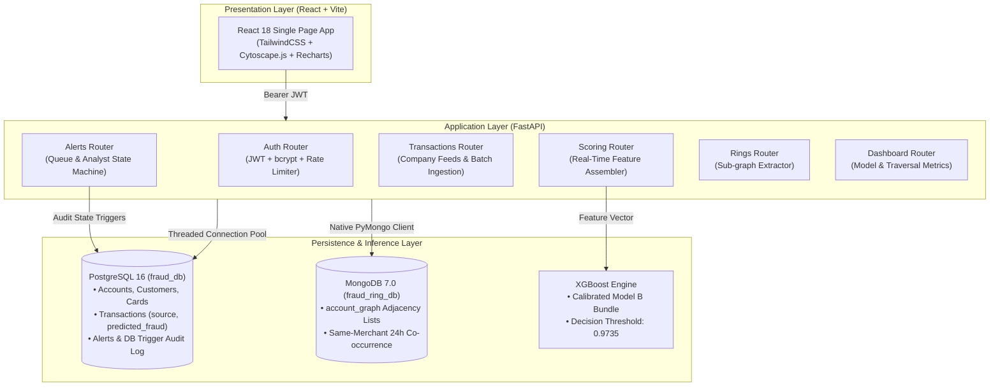

# Intelligent Fraud Ring Detection & Decision-Support System

[](https://www.python.org/)
[](https://fastapi.tiangolo.com/)
[](https://react.dev/)
[](https://www.postgresql.org/)
[](https://www.mongodb.com/)
[](https://xgboost.readthedocs.io/)
[](LICENSE)

An enterprise-grade, human-in-the-loop decision-support platform engineered to detect, visualize, and investigate coordinated financial fraud syndicates. Traditional rules and isolated single-transaction models fail to detect organized rings operating across distributed accounts; this system couples **relational transaction semantics (PostgreSQL)**, **sub-millisecond graph adjacency lookups (MongoDB)**, and **calibrated gradient-boosted trees (XGBoost)** to give bank analysts clear, explainable, and accountable investigative workflows.

---

## 1. System Architecture

The application adopts a **Polyglot Persistence** pattern to isolate relational ACID guarantees from high-degree graph traversal queries:



### Why Polyglot Persistence?
1. **PostgreSQL (`fraud_db`)**:
   - Manages relational financial entities (`customer`, `account`, `transaction`, `alert`, `analyst`).
   - Guarantees strict transactional consistency (ACID) and relational integrity with foreign keys and cascading rules.
   - Enforces tamper-evident compliance via database triggers (`trg_alert_audit`) writing immutable state changes directly to `alert_audit`.
2. **MongoDB (`fraud_ring_db`)**:
   - Stores pre-aggregated 24-hour merchant co-occurrence adjacency lists (`account_graph`).
   - Eliminates recursive relational self-joins (`JOIN` explosion) during multi-hop syndicate ring expansions.
   - Delivers sub-millisecond graph traversal latencies (5.5x–7.4x faster than PostgreSQL recursive CTEs).

---

## 2. Machine Learning Architecture & Feedback-Loop Prevention

### Prevention of Label Contamination
A critical design failure in fraud detection systems is the **prediction feedback loop**: when an automated model score is recorded as ground-truth fraud (`is_fraud = TRUE`), future graph traversals query those predicted accounts as "confirmed fraud hubs," causing snowballing false positives.

* **Separation of Concerns**:
  - `predicted_fraud` (BOOLEAN) & `fraud_probability` (NUMERIC): Store raw model inferences at scoring time.
  - `is_fraud` (BOOLEAN): Exclusively reserved for historical training ground truth or analyst-confirmed investigations.
* **Analyst State Machine**:
  - `is_fraud` is updated to `TRUE` if and only if an analyst investigates an alert and explicitly closes it with a confirmed decision (`Confirmed Fraud Syndicate`, `Account Takeover`, etc.).
  - False positive dismissals explicitly set `is_fraud = FALSE`.
* **Dynamic Cache**:
  - Confirmed fraud account IDs are cached in memory and re-indexed only when an analyst review state changes, preventing costly full-table `SELECT DISTINCT` scans per inference.

### Causal Feature Engineering Pipeline
All features are generated point-in-time strictly before the transaction timestamp:
1. `amount`: Transaction amount (USD).
2. `hour` & `day_of_week`: Temporal cyclical features.
3. `hops_to_flagged`: Shortest BFS network distance to a confirmed fraud account ($0$ = self, $1$ = direct neighbor, $2$ = 2 hops, $3$ = $\ge 3$ hops or disconnected).
4. `degree_centrality`: Normalized network degree ($\frac{\text{degree}}{N - 1}$).
5. `shared_merchant_count_24h`: Number of other accounts transacting at the same merchant within a rolling 24-hour window.
6. `trans_velocity_24h`: Transaction burst volume for the account within 24 hours.
7. `prior_fraud_neighbors_count`: Count of confirmed fraud accounts in the immediate 1-hop merchant neighborhood.

---

## 3. Empirical Model Governance & Benchmarks

Models were trained on **1.85M transactions** (Sparkov synthetic financial stream) split **strictly chronologically** (70% Train, 15% Validation, 15% Test) without data leakage:
* **Train Split**: Earliest 70% ($N = 1,296,051$, fraud rate: $0.58\%$)
* **Validation Split**: Intermediate 15% ($N = 277,725$, fraud rate: $0.57\%$) — used for hyperparameter search and threshold calibration.
* **Test Split**: Final 15% held-out unseen data ($N = 277,860$, fraud rate: $0.33\%$).

### Held-Out Test Evaluation Matrix

| Model | Deployed | Calibrated Threshold | Precision | Recall | F1-Score | PR-AUC | ROC-AUC | False Positives |
| :--- | :---: | :---: | :---: | :---: | :---: | :---: | :---: | :---: |
| **1. Logistic Regression** | No | 0.9796 | 25.60% | 43.94% | 0.3235 | 0.1193 | 0.8361 | 1,180 |
| **2. Random Forest** | No | 0.9807 | 53.11% | 51.73% | 0.5241 | 0.4819 | 0.9767 | 422 |
| **3. XGBoost (Model A - Tx Only)** | No | 0.9799 | 44.13% | 55.74% | 0.4926 | 0.4377 | 0.9801 | 652 |
| **4. XGBoost (Model B - Tx + Graph)** | **YES** | **0.9735** | **48.81%** | **50.97%** | **0.4987** | **0.4777** | **0.9796** | **494** |
| **5. Model B (w/o `hops_to_flagged`)** | No | 0.9691 | 47.92% | 51.08% | 0.4945 | 0.4619 | 0.9804 | 513 |
| **6. Model A + Prior Fraud Count** | Benchmark | 0.9901 | 49.48% | 61.26% | 0.5474 | 0.5858 | 0.9853 | 578 |

### Honest Engineering Takeaways
1. **False Alarm Reduction**: Incorporating multi-hop graph features (Model B) reduced false positive alerts by **24.2%** over transaction-only features (from 652 down to 494 false alarms on the held-out test split) while lifting precision from 44.13% to 48.81% and PR-AUC from 0.4377 to 0.4777.
2. **Structural vs. Historical Baseline**: While Model B outperforms Model A, **Model 6 (Model A + Account's Prior Fraud Count)** achieves a higher PR-AUC (0.5858 vs 0.4777). This demonstrates that direct historical account signals remain the strongest single predictor, and merchant co-occurrence graphs must be complemented with historical ledger data.
3. **Data Scope Disclosure**: The dataset consists of public simulated credit card streams. Graph edges model 24-hour merchant co-occurrence as an identity proxy, rather than direct device/IP hardware signatures.

---

## 4. Multi-Hop Graph Traversal Latency Benchmarks

To quantify the operational advantage of storing network topology in MongoDB over relational SQL recursive Common Table Expressions (CTEs), traversal latencies were measured across 100 trials:

| Traversal Depth | Discovered Nodes | PostgreSQL Recursive CTE (Mean / P95) | MongoDB Adjacency Lookup (Mean / P95) | Latency Speedup |
| :---: | :---: | :---: | :---: | :---: |
| **1-Hop** | 1.0 | 3.20 ms / 6.67 ms | 0.47 ms / 0.79 ms | **6.8x faster** |
| **2-Hop** | 2.0 | 4.26 ms / 6.19 ms | 0.58 ms / 0.84 ms | **7.4x faster** |
| **3-Hop** | 2.0 | 4.38 ms / 7.01 ms | 0.80 ms / 1.02 ms | **5.5x faster** |

*Benchmarks dynamically loaded by the Manager Dashboard from `models/benchmark_results.json`.*

---

## 5. Security Architecture & RBAC

The system implements zero-trust authorization on every endpoint using signed HMAC-SHA256 JWT tokens:

### Role-Based Access Control Matrix

| Capability | Endpoint / Route | Analyst | Manager | Admin |
| :--- | :--- | :---: | :---: | :---: |
| Score Single Transaction | `POST /api/score` | :white_check_mark: | :white_check_mark: | :white_check_mark: |
| Review & Update Alert State | `PATCH /api/alerts/{id}` | :white_check_mark: | :white_check_mark: | :white_check_mark: |
| Inspect Graph Rings | `GET /api/rings/{id}` | :white_check_mark: | :white_check_mark: | :white_check_mark: |
| Ingest Company Records | `POST /api/transactions` | :white_check_mark: | :white_check_mark: | :white_check_mark: |
| View Manager Metrics & ROC | `GET /api/dashboard/metrics` | :x: *(403 Forbidden)* | :white_check_mark: | :white_check_mark: |
| View Graph Benchmarks | `GET /api/dashboard/benchmarks`| :x: *(403 Forbidden)* | :white_check_mark: | :white_check_mark: |
| Bulk Ingest Demo Transactions | `POST /api/transactions/demo-batch`| :x: *(403 Forbidden)* | :x: *(403 Forbidden)* | :white_check_mark: |
| Reset Company Ledger | `DELETE /api/transactions/clear`| :x: *(403 Forbidden)* | :x: *(403 Forbidden)* | :white_check_mark: |

### Defense-in-Depth Mechanisms
* **JWT Secret Integrity**: Application refuses startup if `JWT_SECRET_KEY` is missing or shorter than 32 characters.
* **Brute-Force Rate Limiting**: In-memory rate limiting throttles failed authentication requests (maximum 5 attempts per 60 seconds per IP + username).
* **Connection Pooling**: PostgreSQL connections are pooled using `psycopg2.pool.ThreadedConnectionPool` with deterministic cleanup via FastAPI dependency injection.

---

## 6. Repository Layout

```
.
├── backend/                        # FastAPI REST API Backend
│   ├── main.py                     # App factory, lifespan handlers, CORS, SPA static mounting
│   ├── auth.py                     # JWT token encode/decode & OAuth2 password bearer
│   ├── config.py                   # Configuration schema & JWT secret validation
│   ├── database.py                 # Threaded PG pool & MongoDB connection managers
│   ├── features.py                 # Unified, shared point-in-time feature engineering module
│   ├── schemas.py                  # Pydantic v2 validation contracts
│   └── routers/                    # Modular API domain routers
│       ├── alerts_router.py        # Alert queue, status transitions, review notes
│       ├── auth_router.py          # User login & rate-limited authentication
│       ├── dashboard_router.py     # Manager scorecard & benchmark metrics
│       ├── rings_router.py         # Sub-graph extraction & Cytoscape topology
│       ├── scoring_router.py       # Single-transaction inference & SHAP-style reasons
│       └── transactions_router.py  # User ledger workflow, batch import, reset
├── config/                         # Central database configuration
│   └── db_config.py
├── frontend/                       # React 18 + Vite Frontend Application
│   ├── src/
│   │   ├── api/client.js           # Axios HTTP client with JWT interceptors
│   │   ├── components/             # Reusable UI components (Navbar, ProtectedRoute)
│   │   ├── context/AuthContext.jsx # React context provider for user session
│   │   ├── pages/                  # Page views
│   │   │   ├── AlertQueue.jsx      # Analyst triage queue & review drawer
│   │   │   ├── Login.jsx           # Credential sign-in
│   │   │   ├── ManagerDashboard.jsx# Metrics scorecard, PR-AUC, benchmark charts
│   │   │   ├── RingExplorer.jsx    # Cytoscape interactive network ring graph
│   │   │   └── ScoreTransaction.jsx# Company transaction input, scoring & batch feed
│   │   └── index.css               # Clean, accessible enterprise light theme
│   ├── package.json
│   └── vite.config.js
├── models/                         # Trained ML Artifacts & Visualizations
│   ├── benchmark_results.json      # Pre-computed graph vs SQL latency benchmarks
│   ├── comparison.csv              # Full model evaluation comparison matrix
│   ├── feature_importance.png      # Gain-based XGBoost feature importance plot
│   ├── fraud_model.joblib          # Production Model B bundle (XGBoost + threshold)
│   ├── metrics.json                # Complete metrics JSON for all 6 evaluated models
│   └── precision_recall_curve.png  # PR curve across all evaluated architectures
├── schema.sql                      # Production PostgreSQL DDL with triggers & indices
├── scripts/                        # Production Utilities & Pipelines
│   ├── benchmark_traversal.py      # Traversal benchmark harness (Mongo vs PG)
│   ├── build_merchant_graph.py     # Adjacency list builder for MongoDB account_graph
│   ├── load_postgres.py            # Raw CSV ETL loader into PostgreSQL tables
│   ├── seed_users.py               # Bcrypt password hasher and role user seeder
│   ├── test_v2_api.py              # End-to-end integration test suite
│   └── train_evaluation.py         # ML pipeline: train, tune, evaluate, export
└── tests/                          # Automated Unit & Regression Tests
    └── test_system.py              # Pytest test suite for RBAC, DB triggers, schemas
```

---

## 7. Getting Started

### Prerequisites
* **Operating System**: macOS or Linux
* **Python**: 3.10+ (with `venv` activated)
* **Node.js**: v18+ & `npm`
* **PostgreSQL**: 16+ running locally (`localhost:5432`)
* **MongoDB**: 7.0+ running locally (`localhost:27017`)

### 1. Environment Configuration
Create a `.env` file in the project root:
```env
# Application Secrets (Must be at least 32 characters)
JWT_SECRET_KEY=c2VjdXJlX2ZpbmFuY2lhbF9mcmF1ZF9kZXRlY3Rpb25fa2V5XzIwMjY=
JWT_ALGORITHM=HS256
ACCESS_TOKEN_EXPIRE_MINUTES=480

# PostgreSQL Connection
PG_HOST=localhost
PG_PORT=5432
PG_USER=arnavbansal
PG_PASSWORD=
PG_DATABASE=fraud_db

# MongoDB Connection
MONGO_URI=mongodb://localhost:27017
MONGO_DB_NAME=fraud_ring_db
```

### 2. Database Initialization
```bash
# 1. Initialize PostgreSQL schema (tables, constraints, triggers)
psql -d fraud_db -f schema.sql

# 2. Seed initial analyst, manager, and admin users
.venv/bin/python3 scripts/seed_users.py

# 3. Build MongoDB merchant co-occurrence graph (account_graph)
.venv/bin/python3 scripts/build_merchant_graph.py
```

### 3. Running the Service

#### Option A: Unified Production Mode (FastAPI serves compiled React SPA)
```bash
# Build frontend static bundle
cd frontend && npm install && npm run build && cd ..

# Start backend server
.venv/bin/python3 -m backend.main
```
Navigate to **[http://localhost:8005](http://localhost:8005)**.

#### Option B: Development Mode (Hot Reloading)
```bash
# Terminal 1: Backend API
.venv/bin/uvicorn backend.main:app --port 8005 --reload

# Terminal 2: Frontend Vite Server
cd frontend
npm run dev
```
Navigate to **[http://localhost:5173](http://localhost:5173)**.

---

## 8. Verification & Automated Testing

The repository contains both unit test suites (`pytest`) and live end-to-end API integration tests.

### Run Unit Tests
```bash
PYTHONPATH=. .venv/bin/pytest tests/test_system.py -v
```
**Test Coverage**:
* `test_schemas_import`: Schema definition and class resolution integrity.
* `test_role_enforcement`: RBAC enforcement (Analyst denied on Manager dashboard `403 Forbidden`).
* `test_feature_function`: Causal feature calculation & normalization validation.
* `test_alert_review_audit_record`: Single-record audit logging via database trigger.
* `test_dashboard_metrics_match_json`: API response parity with `models/metrics.json`.

### Run End-to-End Integration Tests
```bash
.venv/bin/python3 scripts/test_v2_api.py
```
Executes a 10-step full workflow against a running server: Authentication $\to$ Role Enforcement $\to$ Model Inference $\to$ Alert Queuing $\to$ State Review $\to$ Audit Trail Verification $\to$ Multi-hop Ring Traversal.

---

## 9. Default User Credentials

| Username | Password | Assigned Role | Primary Dashboard View |
| :--- | :--- | :--- | :--- |
| **`analyst`** | `password123` | `analyst` | Alert Queue & Investigation Workspace |
| **`manager`** | `password123` | `manager` | Manager Dashboard, Governance & Benchmarks |
| **`admin`** | `password123` | `admin` | Full Administration & Batch Operations |

---

## 10. Production Roadmap

* [ ] **Streaming Ingestion**: Replace HTTP REST batch calls with an Apache Kafka consumer group for real-time transaction streaming and CDC (Debezium).
* [ ] **Distributed Graph Processing**: Scale from MongoDB document adjacency lists to a dedicated distributed graph database (e.g., Neo4j / Amazon Neptune / TigerGraph) when node counts exceed 10M+.
* [ ] **Dynamic GNN Inference**: Evaluate inductive Graph Neural Networks (GraphSAGE / RGCN) trained on dynamic temporal bipartite graphs.
* [ ] **MFA / SSO**: Integrate SAML 2.0 / OIDC enterprise authentication with hardware security keys (FIDO2/WebAuthn).
