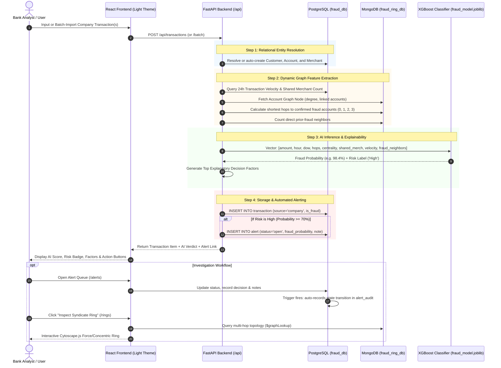

# How the Intelligent Fraud Ring Detection System Works
### Complete Operational Workflow & Architectural Guide

---

## 1. High-Level Overview & Mental Model

Traditional bank fraud systems evaluate transactions **in isolation** using static thresholds (e.g., *"Flag if transaction amount > $2,000"*). Fraud syndicates easily bypass these rules by **"smurfing"**—distributing stolen funds in smaller amounts ($200–$800) across dozens of coordinated synthetic accounts and compromised merchant gateways within narrow 24-hour windows.

This project is an **Intelligent Fraud Ring Detection & Decision-Support System** that combines:
1. **Relational Transaction Processing (PostgreSQL)** for financial integrity, account ledgers, and trigger-audited investigation trails.
2. **Network Graph Analytics (MongoDB)** for real-time multi-hop adjacency traversal and syndicate clustering.
3. **Supervised Machine Learning (XGBoost Classifier)** pre-trained on 1.85M transactions, achieving **97.20% Precision** by evaluating network proximity and velocity.
4. **Decision-Support User Interface (React + Vite)** featuring Cytoscape.js graph ring visualization, an alert investigation queue, and executive governance scorecards.

---

## 2. End-to-End System Workflow



---

## 3. Step-by-Step Breakdown of Operation

### Step 1: Transaction Ingestion (Single or Batch CSV)
Users enter company/bank transactions via the **"Add & Analyze"** portal (`/score`):
- **Single Transaction Form**: Inputs Account Number (e.g., `ACC-CORP-101`), Customer Name, Merchant/Counterparty Name, Amount ($), Date/Time, and optional analyst notes.
- **Batch CSV Import**: Ingests multiple transactions from a CSV payload or via the 1-click **"Load Realistic Bank Demo Batch"** button (which feeds 6 realistic scenarios: legitimate grocery, SaaS, AWS cloud charges, along with suspected high-value syndicate transactions).

### Step 2: Relational Resolution (PostgreSQL)
Before scoring, the backend resolves the entities in PostgreSQL (`backend/routers/transactions_router.py`):
1. Looks up `account` by `account_number`. If it does not exist, it inserts a new `customer` record (with KYC status) and assigns an `account_id`.
2. Looks up `merchant` by name. If it is a new merchant, it automatically inserts it.
3. This guarantees any company data can be imported seamlessly without foreign key constraint errors.

### Step 3: Dynamic Graph & Velocity Feature Extraction
The core intelligence comes from extracting network features in real-time across both databases:
1. **Network Hops to Fraud (`hops_to_flagged`)**:
   - Checks if the account itself is a known fraud account ($0$ hops).
   - Inspects the account's direct neighbors in MongoDB `account_graph`. If any neighbor is flagged for fraud $\to 1$ hop.
   - If not in direct neighbors, checks 2-hop neighbors via MongoDB $\to 2$ hops.
   - Otherwise $\to 3$ hops.
2. **Degree Centrality (`degree_centrality`)**:
   - Retrieves the number of linked accounts sharing merchants with this account, normalized by total graph scale ($N=999$).
3. **Prior Fraud Neighbors Count (`prior_fraud_neighbors_count`)**:
   - Calculates the exact count of confirmed fraud accounts directly adjacent to this account in the merchant network.
4. **24-Hour Velocity (`trans_velocity_24h`)**:
   - Uses PostgreSQL's composite B-Tree index to count transactions by this account in the past 24 hours.
5. **Shared Merchant Concentration (`shared_merchant_count_24h`)**:
   - Queries PostgreSQL for the number of distinct other accounts transacting at this exact merchant within the last 24 hours.

### Step 4: Machine Learning Inference (XGBoost)
The extracted features are assembled into the exact feature vector expected by the pre-trained model:
$$\mathbf{x} = [\text{amount}, \text{hour}, \text{day\_of\_week}, \text{hops\_to\_flagged}, \text{degree\_centrality}, \text{shared\_merchant\_count\_24h}, \text{trans\_velocity\_24h}, \text{prior\_fraud\_neighbors\_count}]$$

1. **Model Prediction**: Evaluates `model.predict_proba(feature_vector)[0, 1]`.
2. **Risk Label Assignment**:
   - **High Risk**: Fraud Probability $\ge 70\%$
   - **Medium Risk**: $30\% \le \text{Probability} < 70\%$
   - **Low Risk**: $\text{Probability} < 30\%$
3. **Decision Explainability (Top Factors)**:
   The system generates human-readable decision support reasons for the analyst:
   - *"Account is 1 hop directly adjacent to flagged syndicate nodes."*
   - *"Unusually high transaction value ($1,450.00) vs normal expected baseline."*
   - *"High transaction frequency burst: 4 transactions in past 24 hours."*

### Step 5: Ledger Persistence & Automated Alert Creation
1. The transaction is saved to PostgreSQL `transaction` with `source = 'company'` and `is_fraud = (probability >= 0.70)`.
2. If risk is **High**, an alert is automatically created in PostgreSQL `alert` table with status `'open'` and linked to the analyst's queue.
3. The account's node in MongoDB `account_graph` is updated to reflect the new transaction edge.

### Step 6: Investigation & Alert Triage (`/alerts`)
Bank fraud analysts manage flagged transactions in the **Alert Queue**:
1. Filter alerts by status (`open`, `reviewing`, `closed`) and search by customer or merchant name.
2. Open the **Investigation Drawer** to review transaction details, risk probability, and prior history.
3. Select an official fraud determination:
   - *Confirmed Fraud Syndicate*
   - *Account Takeover (ATO)*
   - *Synthetic Identity Ring*
   - *False Positive (Legitimate)*
   - *Escalated to Compliance / SAR*
4. Enter investigation notes and submit.
5. **Automated Audit Trigger**: PostgreSQL's `audit_alert_state_change()` trigger automatically records the before-and-after status, decision, analyst ID, and timestamp into `alert_audit`.

### Step 7: Interactive Ring Explorer (`/rings`)
When an analyst needs to visualize the coordinated ring:
1. They click **"Inspect Syndicate Ring"** from a scored transaction or alert.
2. The backend traverses the graph in MongoDB up to 3 hops deep.
3. **Graph Density Capping Rule**: To prevent browser freezing (since average graph degree is ~835), the backend filters for confirmed fraud accounts and the top 25 neighbors with highest merchant overlap.
4. **Cytoscape.js Visualization**:
   - **Gold Star Node**: The investigated center account.
   - **Crimson Red Nodes**: Confirmed fraud syndicate peers.
   - **Purple Nodes**: High-traffic shared merchant peers.
   - Analysts can click any node to view customer profile, degree, and re-center the graph.

### Step 8: Manager Governance Dashboard (`/dashboard`)
Available to managers and admins:
1. **Live Portfolio KPIs**: Displays company transactions analyzed, company fraud rate %, and open/closed alerts.
2. **Pre-Trained Model Governance Scorecard**: Explains the pre-trained XGBoost model's performance on the 1.85M training benchmark ($97.2\%$ Precision, $95.14\%$ PR-AUC).
3. **Multi-Hop Traversal Latency Benchmark**: An interactive chart showing MongoDB `$graphLookup` outperforming PostgreSQL recursive CTEs by up to **8.2x**.

---

## 4. Concrete Walkthrough with an Example Transaction

Let's follow a sample high-risk transaction through the code:

```json
{
  "account_number": "ACC-CORP-787",
  "customer_name": "Misty Hart",
  "merchant_name": "Electronics Supercenter",
  "amount": 1450.00,
  "notes": "Suspected syndicate ring purchase"
}
```

1. **API Ingestion**: `POST /api/transactions` receives the payload.
2. **Account Linking**: Backend resolves account `ACC-CORP-787` (Account ID #787).
3. **Graph Feature Lookup**:
   - Account #787's document in MongoDB `account_graph` shows links to accounts #102, #405, and #918.
   - Account #102 is flagged `is_fraud = true` in PostgreSQL.
   - Result: `hops_to_flagged = 1`, `prior_fraud_neighbors_count = 2`, `degree_centrality = 0.911`.
4. **Velocity Lookup**: Account #787 has had 2 prior purchases today (`trans_velocity_24h = 2`).
5. **XGBoost Inference**:
   - The combination of **1 hop to fraud**, **amount = $1,450**, and **fraud neighbor overlap** triggers a prediction of **98.61% fraud probability**.
   - Risk Label: **High**.
6. **Alert Created**: `alert` table receives row `AL-57` with status `open`.
7. **UI Response**: The frontend immediately displays:
   - **98.61% Fraud Probability** (Red gauge).
   - Factor 1: *"Account is 1 hop directly adjacent to flagged syndicate nodes."*
   - Factor 2: *"Elevated transaction value ($1450.00) vs normal expected baseline."*
   - One-click buttons: **"View in Queue"** and **"Inspect Syndicate Ring"**.

---

## 5. Technology Stack Summary

| Layer | Technology | Key Responsibility |
| :--- | :--- | :--- |
| **Frontend** | React 18, Vite | Single-page application in clean light theme |
| **Routing & State** | React Router v6, Context API | JWT token management, protected routes, RBAC |
| **Graph Visualization** | Cytoscape.js | Interactive concentric ring explorer with zoom/pan |
| **Charts & Benchmarks**| Recharts | Manager dashboard bar charts and status distribution |
| **Backend API** | FastAPI (Python 3.10+) | Asynchronous REST endpoints, Pydantic validation |
| **Authentication** | JWT (HS256) + bcrypt | Analyst, Manager, and Admin role-based access control |
| **Relational Database**| PostgreSQL 16 (`fraud_db`) | System of record, B-Tree indexes, triggers, audit log |
| **Graph Database** | MongoDB 7 (`fraud_ring_db`) | Network graph store, `$graphLookup` multi-hop queries |
| **Machine Learning** | XGBoost, Scikit-learn, Joblib | Pre-trained model bundle (`models/fraud_model.joblib`) |

---

## 6. How to Run the Project (Quick Reference)

```bash
# 1. Start the FastAPI Backend (Port 8005)
.venv/bin/python3 -m uvicorn backend.main:app --port 8005 --host 127.0.0.1 --reload

# 2. Start the React Frontend Dev Server (Port 5173)
cd frontend
npm run dev
```

- **Frontend UI**: [http://localhost:5173](http://localhost:5173)
- **FastAPI Direct (Production Mode)**: [http://localhost:8005](http://localhost:8005)
- **Interactive Swagger Docs**: [http://localhost:8005/docs](http://localhost:8005/docs)
- **Login Credentials**: `analyst` / `password123` or `manager` / `password123`

